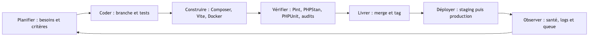
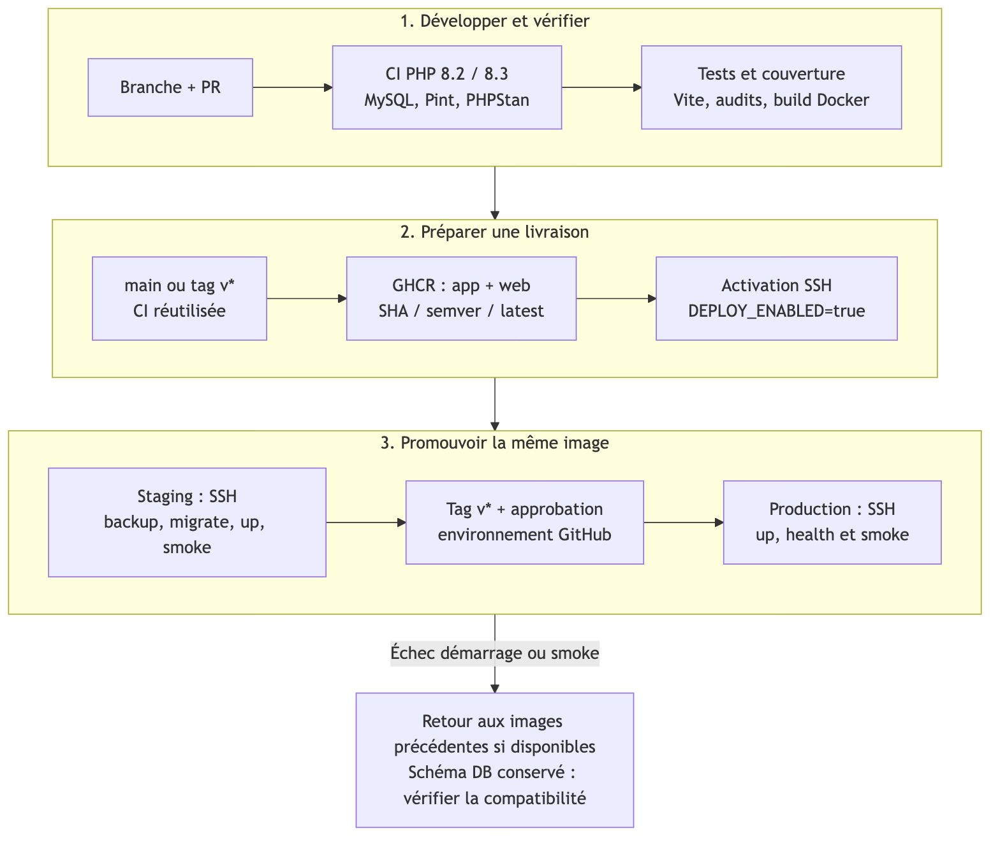
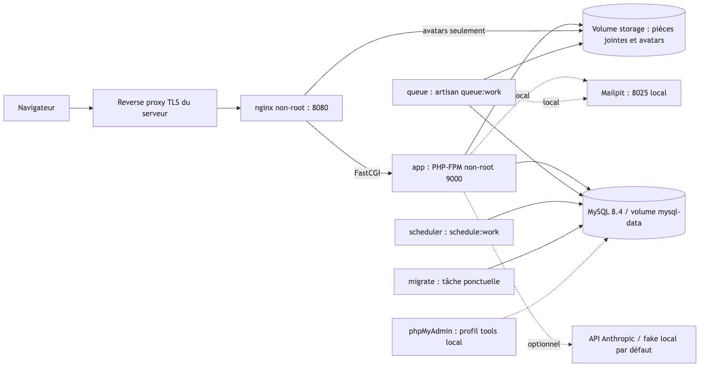

# AquaSecure — dossier DevOps

Version de livraison : v0.6.0 puis v1.0.0. Date : 1 novembre 2026. Auteur : Aziz Douagi, 5TWIN ESPRIT.

## Objectif et périmètre

Rendre l’application Laravel 12 reproductible, testable et livrable avec des preuves consultables. Les sources Docker et GitHub Actions sont versionnées. Leur présence ne constitue pas une preuve de déploiement : le daemon Docker est arrêté sur cette machine et aucun workflow distant n’a été lancé depuis cette session.

## Boucle DevOps



Les besoins deviennent des critères d’acceptation. Le développement ajoute le comportement, ses permissions et des tests métier. La CI vérifie les changements ; la CD construit des images identifiées puis les promeut entre environnements. Les contrôles de santé et journaux servent à diagnostiquer un incident et à ajuster les prochains changements.

Sources Mermaid modifiables dans `docs/diagrams/*.mmd`. Les exports PNG et SVG sont régénérés par `sh scripts/render-diagrams.sh` avec mermaid-cli. Sur macOS, le script utilise Chrome installé si nécessaire ; ailleurs installer le navigateur Puppeteer requis ou renseigner `PUPPETEER_EXECUTABLE_PATH`.

## Workflow Git et versions

Une branche par phase : `feature/auth`, infrastructure, `feature/advanced-incident`, `feature/api-dashboard`, `feature/ai-core`, `feature/ai-features`, `devops/docker`, `devops/ci-cd`, `docs/devops`, `feature/polish`. Les branches historiques peuvent avoir été créées avant cette session. Les nouveaux commits suivent Conventional Commits et portent le trailer `Co-Authored-By: Codex <noreply@openai.com>`.

À chaque clôture : migration et seed sur base de validation dédiée, tests, Pint, puis PHPStan depuis sa configuration. Merge `--no-ff` sur main. Les tags v0.1.0 à v0.4.0 existaient au démarrage ; v0.5.0 regroupe l’IA, v0.6.0 DevOps, v1.0.0 la finalisation. Aucun tag existant n’est réécrit. Aucun push n’est exécuté ici.

```bash
git switch -c feature/mon-sujet
# Implémenter et vérifier
composer ci
npm run build
git add fichiers-explicites
git commit -m "feat(module): décrire le résultat" -m "Co-Authored-By: Codex <noreply@openai.com>"
git switch main
git merge --no-ff feature/mon-sujet
git tag -a vX.Y.Z -m "Description de la version"
```

Le hook `.githooks/pre-commit` lance Pint, PHPStan et les tests. Activation volontaire sur une nouvelle copie : `git config core.hooksPath .githooks`. La CI reste nécessaire même si le hook est contourné. En équipe, protéger main, imposer les contrôles et une revue ; ces réglages GitHub restent manuels.

## Pipeline CI vers CD



`ci.yml` traite les pull requests et les branches de phase. `cd.yml` reçoit main et les tags v*, et appelle la même CI avant publication. La matrice PHP 8.2/8.3 utilise un service MySQL 8.4, Composer avec cache, Pint, Larastan niveau 5, tests PHPUnit avec Xdebug et artefacts Clover/JUnit conservés 14 jours. Node 22 construit Vite. Les audits Composer et npm sont bloquants pour les vulnérabilités selon leur seuil (`npm` : high). Un job distinct construit les deux cibles Docker et effectue un smoke Compose ; il n’a pas pu être reproduit localement.

Le verrou Composer a été réaligné sur `config.platform.php=8.2.0` : Spatie Permission 6.25 remplace la version 8 exigeant PHP 8.3 et les dépendances Symfony sont compatibles PHP 8.2. Les tests de permissions sont rejoués après ce changement. PHPStan passe sans baseline ; les relations et dates Eloquent sont annotées. La machine possède PHP 8.5 et PHP 8.2 ; PHP 8.3 sera vérifié par la matrice distante.

Après succès, deux images sont publiées dans GHCR : application et web. Identifiants `sha-<SHA complet>`, semver sur tags, et `latest` sur releases. Le déploiement utilise les identifiants SHA. `GITHUB_TOKEN` reçoit uniquement `packages:write` dans le job de publication. Les autres jobs ont `contents:read`.

## Architecture et construction Docker



`Dockerfile` : Node 22 compile les assets ; un étage PHP installe les dépendances Composer sans dev ; l’image `app` utilise PHP 8.3-FPM, les extensions MySQL/SQLite, mbstring, intl, gd, zip, bcmath, pcntl et opcache, puis tourne sous UID 1000. L’image `web` utilise Nginx non privilégié, embarque les mêmes assets et ne sert qu’index.php côté PHP. Les secrets, dépendances locales, caches, bases SQLite et logs sont exclus du contexte.

Les services app, queue, scheduler et migration partagent une image et le volume storage. MySQL possède son volume persistant. Nginx lit les avatars publics ; les pièces jointes d’incident restent privées et passent par les policies du contrôleur. La migration ponctuelle attend MySQL sain ; app attend la migration réussie ; Nginx et les workers attendent PHP-FPM sain. Les healthchecks des workers vérifient le processus ; ils ne garantissent pas que tous les jobs aboutissent.

Le Compose local fournit Mailpit et phpMyAdmin sous profil `tools`, liés uniquement à 127.0.0.1. Le fichier `docker-compose.prod.yml` est **autonome** : il exclut ces outils, les builds et les montages du code source, impose APP_DEBUG=false, et reçoit les images ainsi que `.env.production` du serveur. Ne pas le superposer au Compose local.

## Installation et exploitation locale

```bash
cp .env.docker.example .env.docker
# Générer une clé, puis renseigner APP_KEY dans .env.docker :
php -r 'echo "base64:".base64_encode(random_bytes(32)).PHP_EOL;'
make build
make up
make seed                 # uniquement la base de démonstration
make health
# Application : http://localhost:8080 ; Mailpit : http://localhost:8025
docker compose --env-file .env.docker --profile tools up -d phpmyadmin
make logs
make down                # conserve les volumes
```

Modifier les mots de passe d’exemple. `make seed` ajoute des données ; ne pas le répéter sur une base à conserver. `migrate:fresh --seed` est réservé à une base jetable. L’entrypoint exige APP_KEY ; il ne génère aucune clé, ne seed pas et ne lance pas les migrations. En production il prépare les caches de configuration, routes et vues avant le processus principal.

## Environnements, secrets et activation CD

| Élément | Local | Staging | Production |
|---|---|---|---|
| Base | SQLite ou MySQL démonstration | MySQL isolé | MySQL persistant sauvegardé |
| IA | fake | fake ou clé de test | clé dédiée facultative |
| Mail | log / Mailpit | SMTP de test | SMTP choisi par l’exploitant |
| Déploiement | manuel | main ou tag après CI | tag après staging et approbation |
| Debug | autorisé localement | false | false |

1. Préparer un serveur Linux avec Docker Engine, Compose v2 récent, bash, flock, curl et gzip. Créer deux répertoires et projets Compose distincts (par exemple `/srv/aquasecure-staging` et `/srv/aquasecure-production`).
2. Copier `.env.production.example` en `.env.production` **sur chaque serveur**, remplir APP_KEY, APP_URL, DB_PASSWORD, DB_ROOT_PASSWORD, SMTP, cookies HTTPS et éventuellement la clé IA. Permissions 600. Ne jamais commiter ni transmettre ce fichier dans les artefacts CI.
3. Mettre un reverse proxy TLS devant 127.0.0.1:8080 ; choisir un APP_PORT distinct si les deux environnements partagent une machine. Configurer les proxys de confiance explicitement avant d’exposer Laravel derrière TLS. Ouvrir uniquement SSH et HTTPS au réseau.
4. Authentifier le serveur à GHCR avec un compte à lecture des packages ; utiliser un jeton limité pour un registre privé. Le jeton n’est pas inclus dans ce dépôt.
5. Créer les environnements GitHub `staging` et `production`. Pour chacun : secrets `SSH_HOST`, `SSH_USER`, `SSH_PORT` (optionnel, 22), `SSH_PRIVATE_KEY`, `SSH_KNOWN_HOSTS` (empreinte vérifiée hors bande) ; variable `DEPLOY_PATH`.
6. Configurer **Required reviewers** et les restrictions de branches/tags de l’environnement production. Cette approbation est un réglage GitHub, pas un effet automatique du YAML ; vérifier sa disponibilité sur le forfait choisi.
7. Activer la variable de dépôt `DEPLOY_ENABLED=true`. Tant qu’elle manque, les jobs SSH sont ignorés. La publication GHCR après CI reste prévue sur main/tag. Pousser les branches/tags uniquement après revue des changements et de la configuration distante.

## Déploiement, données et rollback

`scripts/ssh-deploy.sh` utilise une clé temporaire, un known_hosts fourni et StrictHostKeyChecking. Les noms de serveur, utilisateur, chemin et images sont validés. Seuls le Compose de production et le script serveur sont transférés. `scripts/deploy.sh` prend un verrou flock, télécharge les images et démarre MySQL, sauvegarde la base, puis lance `migrate --force`. Il démarre app, nginx, queue et scheduler avec attente des healthchecks et appelle `/up` et `/health`. Les workers sont recréés avec l’image publiée.

La release validée est écrite dans `.release.env`, l’ancienne dans `.release.previous.env`. En cas d’échec du démarrage ou du smoke, le script tente de rétablir les images précédentes ; au tout premier déploiement il n’y a pas encore d’image de secours. Les migrations déjà appliquées restent en place. Un échec de migration interrompt la livraison : investiguer avant toute autre action.

Rollback manuel d’images sur le serveur :

```bash
cd /srv/aquasecure-production
# Lire et confirmer les SHA de .release.previous.env avant la commande.
docker compose --env-file .env.production --env-file .release.previous.env -f docker-compose.prod.yml pull
docker compose --env-file .env.production --env-file .release.previous.env -f docker-compose.prod.yml up -d --no-deps --wait app nginx queue scheduler
curl --fail http://127.0.0.1:8080/up
curl --fail http://127.0.0.1:8080/health
# Après validation, conserver une copie puis remettre à jour .release.env.
```

Les migrations doivent suivre une stratégie additive et rétrocompatible. Pas de `migrate:rollback` automatique : il pourrait détruire des données ou rendre les versions incompatibles. Les sauvegardes `backups/pre-deploy-*.sql.gz` sont locales, permissions privées ; prévoir rétention, copie chiffrée hors serveur et exercices de restauration sur un environnement isolé. En cas de restauration nécessaire : suspendre les écritures, identifier le bon dump, restaurer avec accord de l’exploitant et accepter explicitement le risque de perte depuis la sauvegarde. Un simple rollback d’image ne restaure pas la base ni les fichiers téléversés.

## Supervision et diagnostic

- `/up` : disponibilité du framework ; `/health` : requête SQL simple, HTTP 200 ou 503 sans détail de connexion.
- PHP-FPM : ping FastCGI ; Nginx : `/health`. Queue/scheduler : processus actif et redémarrage Docker. Compléter avec `php artisan queue:failed`, alertes sur la profondeur de file et un observateur externe de `/health`.
- Canal `json` vers stderr, utilisé par Compose. `docker compose logs --since=10m app queue scheduler nginx` pour l’investigation. Prévoir une rotation des logs Docker et une collecte centralisée avant exploitation durable.
- Vérifier les timers avec `php artisan schedule:list`, les incidents suggérés dans `/admin/ia/anomalies`, les erreurs IA et quotas dans ai_logs. Aucun prompt ni clé dans ce journal.
- Les dépendances sont surveillées par Dependabot (Composer/npm/actions/Docker). Les PR exigent une revue et repassent la CI. Codecov/Sonar ne sont pas configurés ; les rapports Clover/JUnit restent téléchargeables dans les artefacts GitHub si la CI s’exécute.

## Critères et preuves

| Critère | Preuve versionnée | Vérification réelle ici |
|---|---|---|
| Conteneurisation | Dockerfile, docker/, deux Compose | Syntaxe Compose valide ; daemon absent, build/up non exécutés |
| Automatisation qualité | composer ci, phpstan.neon, hook | Tests et PHPStan niveau 5 verts sans baseline ; Pint vert |
| CI et couverture | ci.yml, matrice, MySQL, artefacts | YAML parsé et actionlint validé ; exécution GitHub non réalisée |
| CD et approbation | cd.yml, deploy.yml, scripts SSH | Syntaxe shell valide ; SSH/GHCR/environnements non configurés ici |
| Gestion versions | branches, merges --no-ff, tags | Historique local consultable, aucun push |
| Disponibilité et logs | HealthController, canal JSON, healthchecks | Tests HTTP de santé verts ; supervision externe non installée |
| Documentation livrable | Mermaid, PNG/SVG, ce dossier, PDF | Exports produits par mmdc et dompdf, sans pandoc |

## Régénération du PDF et contrôles

```bash
sh scripts/render-diagrams.sh
php scripts/export-docs.php
php scripts/check-yaml.php
composer ci
npm ci && npm run build
# Sans afficher les secrets de configuration :
docker compose --env-file .env.docker.example config --quiet
```

Le PDF `docs/AquaSecure_DevOps.pdf` utilise les images PNG locales, CommonMark et dompdf. La version Markdown reste la source de vérité. Les limites globales et résultats finaux sont consignés dans `docs/RAPPORT_FINAL.md` et `docs/VALIDATION.md`.

## Références techniques

[Ordre de démarrage Compose](https://docs.docker.com/compose/how-tos/startup-order/) ; [déploiement Laravel 12](https://laravel.com/framework/docs/12.x/deployment) ; [Docker build-push-action](https://github.com/docker/build-push-action) ; [artefacts GitHub Actions](https://docs.github.com/en/actions/how-tos/manage-workflow-runs/download-workflow-artifacts). Ces références décrivent les mécanismes employés ; les fichiers du dépôt précisent les choix AquaSecure.
